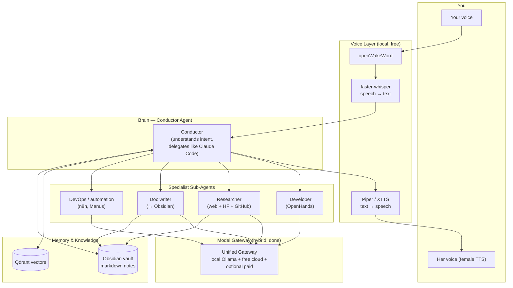

# AI-OS — Roadmap to a Voice-Driven, Fully-Open-Source AI Operating System

> **The vision, in one sentence:** A bootable appliance where you *speak* to one
> orchestrator AI (in a natural female voice), and it delegates work to a team of
> specialist AI agents — developer, researcher, doc-writer — that build software,
> run research, and automate tasks for you. **Free and open-source by default**;
> optional API tokens (GitHub, cloud LLMs) unlock extras but are never required.

This is the master plan. It builds on the now-working AI-OS backend (hybrid model
gateway, agent mesh, dashboard) and the appliance kit already delivered.

---

## 1. Core principles

1. **Free & open-source first.** Everything runs locally with open models. Cloud
   is *optional* and, where used, defaults to **free tiers** (Groq, Gemini free,
   OpenRouter free models, HuggingFace Inference).
2. **Voice-first.** The primary interface is talking. Text/dashboard is the fallback.
3. **AI-orchestrated.** One "Conductor" agent receives your intent and assigns
   tasks to sub-agents — the same pattern Claude Code uses to fan out work.
4. **Tokens optional, collected at install.** A first-run wizard asks for any keys
   you want (GitHub, Groq, etc.). Skip them all → it still works, fully local.
5. **Appliance.** Boots straight into the assistant. Linux is invisible plumbing.

---

## 2. "Everything free" — the stack

| Layer | Free / open-source choice | Optional paid upgrade |
|---|---|---|
| **Local LLMs** | **Ollama** (Llama 3.x, Mistral, Qwen, **Hermes**, DeepSeek) | — |
| **Free cloud LLMs** | **Groq** (free tier, very fast), **Google Gemini** (free tier), **OpenRouter** (free models), **HuggingFace** Inference | OpenAI / Anthropic (paid) |
| **Speech → Text** | **faster-whisper** (local, open) | — |
| **Text → Speech (female voice)** | **Piper** (fast, local, female voices) or **Coqui XTTS-v2** (natural, voice-clone) | ElevenLabs (paid) |
| **Wake word** ("Hey …") | **openWakeWord** (open) | — |
| **Vector memory** | **Qdrant** (open) — already integrated | — |
| **Knowledge base / notes** | **Obsidian vault** (local markdown) | Obsidian Sync (paid) |
| **Autonomous coding agent** | **OpenHands** (open, self-host) | — |
| **Multi-agent frameworks** | **CrewAI**, **LangGraph**, **Microsoft AutoGen** (all open) | — |
| **Desktop automation** | **Manus desktop** module (in repo) | — |
| **Workflow automation** | **n8n** (open, in repo) | — |
| **Image gen** | **ComfyUI** (open, in repo) | — |

> Interpreting your notes: *"open claw"* → **OpenHands**; *"Hermes"* → **Hermes**
> open models (NousResearch, via Ollama/HF); *"Langen"* → **LangGraph/LangChain**;
> *"Microsoft agents"* → **AutoGen**; *"g-t-t-x"* → **gTTS** (but we'll use **Piper**
> for a local, free female voice instead). Correct me on any of these.

---

## 3. Architecture

**Already built (green):** the Model Gateway (hybrid routing), the agent mesh
(6 agents + coordinator), the dashboard, and the bootable appliance kit.
**To build:** the Voice Layer, the Conductor orchestration, and the deeper
integrations (OpenHands, CrewAI/LangGraph/AutoGen, Obsidian, install wizard).

---

## 4. First-run setup wizard (tokens optional, all free)

On install, the appliance asks for keys — **every one is skippable**. Where to get
the free ones:

| Key | Free? | Where to get it | Unlocks |
|---|---|---|---|
| *(none)* | | — | Full local operation via Ollama + Whisper + Piper |
| **Groq API key** | Free tier | console.groq.com | Very fast free cloud inference |
| **Google Gemini key** | Free tier | aistudio.google.com | Free cloud LLM + vision |
| **HuggingFace token** | Free | huggingface.co/settings/tokens | HF models + Inference API |
| **OpenRouter key** | Free models | openrouter.ai | Access many models, some free |
| **GitHub token** | Free | github.com/settings/tokens | Repo read/write, code research |
| GitHub Copilot | Paid* | github.com/features/copilot | Copilot completions (*free for students/OSS maintainers) |
| OpenAI / Anthropic | Paid | their consoles | Top-tier cloud models |

The wizard writes these into `.env`; the gateway already skips any provider whose
key is absent and falls back to local. **So "free by default" is already how the
routing behaves.**

---

## 5. Phased roadmap

Each phase ends with something you can **actually use and test** — no big-bang.

### Phase 0 — Fix the app *(DONE)*
Boots, hybrid local+cloud routing, clean 53-endpoint API, dashboard wired, real
local-model chat + agents verified working. 6 real bugs fixed.

### Phase 1 — Bootable kiosk appliance *(DELIVERED)*
`deploy/` kit: Ubuntu VM boots straight into the dashboard. (Not yet run on a real VM.)

### Phase 2 — Voice Layer *(DONE — the distinctive part)*
- Local **faster-whisper** STT ([core/voice/stt.py](src/ai_os/core/voice/stt.py)) +
  **Piper** female-voice TTS ([core/voice/tts.py](src/ai_os/core/voice/tts.py)).
- Voice API: `/api/v1/voice/status | transcribe | speak | chat`, wired to the hybrid gateway.
- Push-to-talk page at **`/voice-ui`** ([frontend/voice.html](frontend/voice.html)).
- Packaged as the `voice` pip extra; installer fetches engines + the Amy female voice.
- **Verified round-trip:** spoke "What is the capital of France?" → Whisper heard it →
  llama3.2:3b answered "…Paris…" → Piper spoke the reply (11.5s WAV). Fully local & free.
- *Remaining sub-piece:* always-listening **wake word** (openWakeWord) — a small add.

### Phase 3 — The Conductor (AI managing AIs) *(DONE)*
- Orchestrator that parses a goal, **plans** it into steps, **delegates** each to a
  specialist agent (developer/researcher/analyst/writer), feeds results forward, and
  **synthesizes** a final answer — the "one brain assigns work to many" pattern.
- Files: [core/orchestrator/conductor.py](src/ai_os/core/orchestrator/conductor.py),
  [api/routes/conductor.py](src/ai_os/api/routes/conductor.py). Built on the existing
  `AgentCoordinator` + hybrid gateway (fully local-capable). Robust JSON-plan parsing
  with a single-step fallback so it never hard-fails.
- API: `/api/v1/conductor/status | run | voice` (voice = speak a goal → orchestrate → spoken answer).
- *CrewAI / LangGraph / AutoGen become pluggable planner backends in Phase 6; this first
  Conductor is a lightweight LLM planner with no heavy framework lock-in.*

### Phase 4 — Developer agent (autonomous builder) *(DONE — built-in; OpenHands optional)*
- Built-in builder ([core/dev/developer.py](src/ai_os/core/dev/developer.py)): plans a
  project → generates each file → writes it into an isolated **workspace** (path-safety
  checks) → **safely verifies** generated Python by syntax-compiling it (never executes
  untrusted commands; the run command is returned for you to run).
- **OpenHands** is a pluggable, opt-in backend ([core/dev/openhands_client.py](src/ai_os/core/dev/openhands_client.py)):
  set `DEV_BACKEND=openhands` + `OPENHANDS_URL` to delegate to a real OpenHands server;
  otherwise it falls back to the built-in builder.
- API: `/api/v1/developer/status | build | projects | projects/{name}/files | .../file`.
- **Test:** "build a FastAPI hello API" → scaffolds a runnable project on disk.
- *Honest scope:* the built-in builder scaffolds + generates real files (verified); full
  autonomous run/debug loops are OpenHands' job (heavy, external). GitHub commit/PR wiring
  can layer on next.

### Phase 5 — Knowledge & Obsidian *(DONE)*
- An **Obsidian vault** (folder of markdown notes w/ frontmatter, #tags, [[wikilinks]])
  is the shared brain: agents read/write notes and recall from them.
  [core/knowledge/vault.py](src/ai_os/core/knowledge/vault.py) + RAG in
  [api/routes/knowledge.py](src/ai_os/api/routes/knowledge.py).
- Keyword retrieval works **fully offline** (no models/services); embeddings/Qdrant
  are a documented optional upgrade.
- API: `/api/v1/knowledge/status | notes | note | search | ask | remember`.
- **Verified:** wrote notes → asked *"what did we decide about the database schema?"* →
  recalled the right note (ignored a distractor), answered correctly, **cited the source**.

### Phase 6 — Framework & tool breadth *(DONE)*
- **Free cloud is now real:** added **Groq** + **OpenRouter** (OpenAI-compatible) to the
  gateway — free-tier keys route and join the hybrid fallback.
- **First-run setup wizard** ([api/routes/setup.py](src/ai_os/api/routes/setup.py) + `/setup-ui`):
  collects optional keys (allowlisted, never echoed), writes `.env`, activates instantly,
  flips the box to hybrid. Fully verified.
- **Pluggable Conductor backends** ([core/orchestrator/backends.py](src/ai_os/core/orchestrator/backends.py)):
  registry detects CrewAI / LangGraph / AutoGen; `CONDUCTOR_BACKEND` selects one (falls back
  to the built-in planner). `/api/v1/conductor/backends` reports availability.
- **Conductor → vault:** `POST /conductor/run {remember:true}` saves the answer as a note.
- *Honest scope:* framework **execution** adapters are extension points (activate when you
  install the framework); Manus/n8n/ComfyUI need their own servers to be live.

### Phase 7 — Distributable image *(DONE — build kit)*
- A complete **debian-live-build kit** ([deploy/iso/](deploy/iso/)) that bakes the whole
  appliance (app + services + kiosk) into a bootable **`ai-os-amd64.iso`**.
- One command on a Debian/Ubuntu host: `sudo bash deploy/iso/build-iso.sh`.
- Heavy models (Ollama model, Piper voice) are fetched on **first boot**
  ([deploy/firstboot.sh](deploy/firstboot.sh)) to keep the ISO lean.
- *Honest scope:* the kit is assembled + syntax-checked; the actual `lb build` runs on a
  Linux host (can't be built on Windows). Boots on any VM or USB stick.

### Phase 8 — Hot-path engine *(DONE — profiling-driven)*
- **Profiled first:** the only genuinely CPU-bound path was vault **search**
  (~488–1100 ms/query over 1500 notes — it re-read + re-tokenized every note each query).
- **The real win was algorithmic, not C++:** an in-memory **inverted index**
  ([core/knowledge/index.py](src/ai_os/core/knowledge/index.py)) → **~62× faster**
  (488 ms → 7.9 ms/query), verified, built incrementally on writes.
- **C++ accelerator** ([native/aios_native.cpp](native/aios_native.cpp), pybind11):
  an optional compiled tokenizer with a transparent pure-Python fallback
  (`native_tokenizer` shows in `/knowledge/status`). Builds where a compiler exists.
- *Honest takeaway:* profiling proved the fix was an index, not a language rewrite;
  the C++ module is a marginal extra on top. This is exactly "optimize only what
  profiling justifies."

---

## 6. Honest reality checks

- **This is a multi-month build.** Each phase is real engineering. The plan is
  designed so you get a usable result at the end of *every* phase.
- **Hardware matters for "all local + free."** Local LLMs + Whisper + TTS run on
  CPU but are slow; **a GPU (even 8–12 GB) transforms the experience.** On a weak
  VM, lean on the free cloud tiers (Groq/Gemini) for the heavy models.
- **"Fully autonomous developer" is the hardest part.** OpenHands is impressive but
  not magic — expect supervision, especially early. Voice → correct large app in one
  shot is aspirational; voice → scaffold + iterate is realistic today.
- **Copilot isn't free** for most users (it's a paid product); we integrate it only
  if you have it. The *open* equivalents (Ollama code models, OpenHands) are free.
- **Everything else here is genuinely free/open-source.**

---

## 7. What exists today (your head start)

Already in the repo: hybrid model gateway • 6-agent mesh + coordinator • dashboard •
appliance kit • integration stubs for **Manus, GitHub, HuggingFace, Qdrant, n8n,
ComfyUI, DevOps**, plus research agents. Phase 2+ builds on all of it.

---

*Next step: confirm the tool interpretations in §2, then I start **Phase 2 (Voice
Layer)** — the piece that makes it feel alive.*
